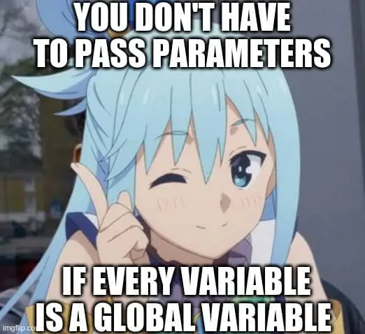

 
<table width="100%" align="center">
  <tr>
    <td width="55%" valign="top">
      

        Linux |
        Web development |
        AI development |
        Games and Software
      

    </td>
  </tr>
</table>

<h3 align="center"><strong>Connect with Me</strong></h3>

  &nbsp;&nbsp;
  &nbsp;&nbsp;
  &nbsp;&nbsp;
  

<h3 align="center"><strong>Tech Stack</strong></h3>
<table width="100%" cellpadding="0" cellspacing="0" border="0"><tr>
    <td width="60%" valign="middle" align="center"></td>
    <td width="40%" valign="middle" align="center"></td>
  </tr>
</table>

  

